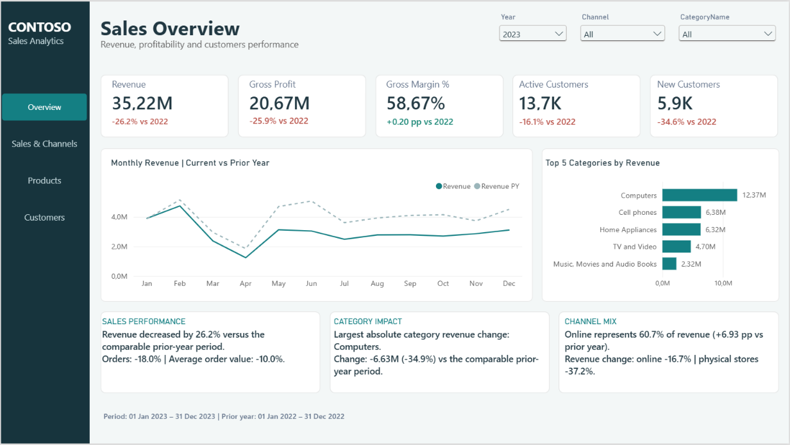

# Contoso Sales Analytics | Power BI

**Analiza sprzedaży, rentowności, kanałów i klientów**

**Narzędzia:** Power BI Desktop · Power Query · DAX  

Projekt portfolio przedstawia czterostronicowy raport sprzedażowy przygotowany w Power BI. Jego celem jest pokazanie, jak zmieniały się wyniki sprzedaży i rentowność oraz które kanały, kategorie produktów i grupy klientów wymagają dalszej analizy.



---

## Executive summary

Dla **pełnego 2023 roku**, wszystkich kanałów i kategorii, w porównaniu z pełnym 2022 rokiem:

| Wskaźnik | 2022 | 2023 | Zmiana |
|---|---:|---:|---:|
| Revenue | 47,71 mln | 35,22 mln | −26,2% |
| Gross Profit | 27,90 mln | 20,67 mln | −25,9% |
| Gross Margin | 58,48% | 58,67% | +0,20 p.p. |
| Orders | 18 895 | 15 503 | −18,0% |
| Units Sold | 143 836 | 118 173 | −17,8% |
| Active Customers | 16 388 | 13 746 | −16,1% |
| New Customers | 9 010 | 5 890 | −34,6% |
| Returning Customers | 7 378 | 7 856 | +6,5% |
| Online Revenue Share | 53,76% | 60,69% | +6,93 p.p. |

Przychód spadł o **26,2%**, a zysk brutto o **25,9%**, mimo niewielkiego wzrostu marży brutto. Spadła zarówno liczba zamówień, jak i średnia wartość zamówienia.

Kanał stacjonarny odpowiadał za około **65,8% łącznego spadku przychodów**. W analizie kategorii największy spadek kwotowy wystąpił w kategorii **Computers** — około **53,1% łącznego spadku**. Są to różne przekroje tych samych danych, dlatego udziałów nie należy sumować.

Udział online wzrósł z **53,76% do 60,69%**, chociaż przychód tego kanału również spadł. Było to wynikiem szybszego spadku sprzedaży stacjonarnej.

> Zmiany w punktach procentowych obliczono przed zaokrągleniem wartości w tabeli. Waluta nie została potwierdzona w dostarczonych danych.

## Cel i pytania biznesowe

Celem projektu jest stworzenie raportu, który pozwala szybko ocenić wyniki sprzedaży, a następnie przejść do analizy kanałów, kategorii i klientów.

Raport odpowiada na pytania:

1. Jak zmieniły się przychód, zysk brutto i marża względem porównywalnego okresu poprzedniego roku?
2. Jak zmieniły się liczba zamówień, liczba sprzedanych sztuk i średnia wartość zamówienia?
3. Który kanał miał większy udział w zmianie przychodów?
4. Które kategorie generują największy przychód i jak różnią się pod względem marży?
5. Jak zmieniła się liczba aktywnych, nowych i powracających klientów?
6. Jak wygląda miesięczna aktywność klientów i ich struktura według kraju profilu?

Raport jest projektem portfolio opracowanym na dostarczonych danych.

## Zakres danych i model

Źródło stanowi pięć plików CSV: `Sales`, `Product`, `Store`, `Customer` i `Date`.

| Element | Opis |
|---|---|
| Zakres dat sprzedaży | 1 stycznia 2015 – 20 kwietnia 2024 |
| Zakres kalendarza | Do 31 grudnia 2024 |
| Pozycje sprzedaży | 199 873 |
| Unikalne zamówienia | 83 130 |
| Poziom szczegółowości | Jedna pozycja w tabeli `Sales` odpowiada jednej linii zamówienia |
| Data analizy | `Sales[OrderDate]` |

Model opiera się na tabeli faktów `Sales`, połączonej relacjami jeden do wielu z tabelami `Date`, `Product`, `Store` i `Customer`. Miary są uporządkowane w tabeli `_Measures`, a tabele pomocnicze `Comparison Year` i `Sales Bridge Steps` wspierają wybrane wizualizacje.

### Widok modelu danych


## Przygotowanie danych

W Power Query przygotowano dane do analizy, w szczególności:

- poprawiono nagłówki i typy danych, w tym typy dat i liczb;
- uwzględniono wartości `#N/D`, puste pola oraz różne separatory dziesiętne;
- sprawdzono konwersję cen i kosztów po wykryciu zawyżonych kwot w kontroli raportu.

W modelu danych przygotowano także podział na kanały **Online** i **Physical store** oraz informację o pierwszym zaobserwowanym zakupie klienta.

W danych źródłowych występuje **5 pozycji bez ceny** oraz **2 pozycje bez kosztu**. Obie pozycje bez kosztu nie mają również ceny; wszystkie te pozycje pochodzą z 2015 roku.

## Strony raportu

Zrzuty przedstawiają raport przygotowany w Power BI Desktop. Widoczne na nich wartości zależą od wybranych filtrów.

### 1. Sales Overview

Strona główna przedstawia najważniejsze KPI, miesięczny trend przychodu w porównaniu z poprzednim rokiem, pięć kategorii o najwyższym przychodzie oraz komentarze dotyczące wyniku, kategorii i kanałów.

Pomaga odpowiedzieć na pytanie: **co zmieniło się w wynikach sprzedaży?** Zrzut strony znajduje się na początku dokumentu.

### 2. Sales & Channels

Analiza liczby zamówień, sprzedanych sztuk i średniej wartości zamówienia. Wykres waterfall pokazuje zmianę przychodu według kanału, a pozostałe wizualizacje przedstawiają wyniki online i sklepów stacjonarnych, strukturę sprzedaży oraz miesięczną liczbę zamówień.


### 3. Product Performance

Analiza przychodów, rentowności i zmian według kategorii produktów. Wykres bąbelkowy zestawia przychód z marżą; wielkość bąbelka odzwierciedla liczbę sprzedanych sztuk. Drugi wykres pokazuje zmianę przychodu kategorii względem poprzedniego roku.


### 4. Customer Overview

Strona pokazuje aktywnych, nowych i powracających klientów, przychód i liczbę zamówień na klienta, miesięczną aktywność oraz strukturę według kraju profilu klienta.

Grupa **Other** jest stałym połączeniem Netherlands, France i Italy. Nie jest dynamiczną kategorią „pozostałe poza Top 5”.


## Najważniejsze definicje

| Wskaźnik | Definicja i interpretacja |
|---|---|
| Revenue | Suma iloczynów ilości i ceny dla pozycji z dostępną ceną. |
| Gross Profit | Suma ilości pomnożonej przez różnicę ceny i kosztu dla pozycji z kompletną ceną i kosztem. |
| Gross Margin % | Zysk brutto podzielony przez przychód dla tego samego zakresu pozycji z kompletną ceną i kosztem. Jest to wskaźnik ważony, a nie średnia marż poszczególnych pozycji. |
| Orders | Liczba unikalnych `OrderKey`. Jedno zamówienie może zawierać kilka pozycji. |
| Units Sold | Liczba sprzedanych sztuk. |
| Average Order Value | Przychód podzielony przez liczbę unikalnych zamówień. |
| Active Customers | Liczba unikalnych klientów, którzy dokonali zakupu w wybranym okresie i zakresie filtrów. |
| New Customers | Aktywni klienci, których pierwszy zakup zaobserwowany w dostępnych danych przypadł na wybrany okres. |
| Returning Customers | Aktywni klienci, których pierwszy zaobserwowany zakup nastąpił wcześniej. Liczba ta nie jest stopą retencji. |
| Online Revenue Share | Udział przychodu online w przychodzie dla wybranego zakresu filtrów. |
| YoY / p.p. | YoY opisuje zmianę względem poprzedniego roku; różnicę między udziałami i marżami wyrażono w punktach procentowych. |

Historia zakupów zaczyna się w 2015 roku, dlatego **pierwszy zaobserwowany zakup nie musi być pierwszym zakupem klienta w historii firmy**. Data pierwszego zakupu jest wyznaczana globalnie dla klienta, a nie ponownie dla każdej kategorii lub kanału.

## Wybrane miary DAX

Poniższe przykłady pochodzą z dokumentacji projektu i ilustrują przyjętą logikę obliczeń. Nie są automatycznym eksportem końcowego modelu PBIX — przed traktowaniem ich jako dokładnych definicji raportu należy porównać je z miarami w pliku Power BI.

### Revenue

Przychód jest sumą wartości poszczególnych pozycji sprzedaży. Pozycje bez ceny nie wnoszą kwoty do wyniku.

```dax
Revenue =
SUMX (
    FILTER ( Sales, NOT ISBLANK ( Sales[UnitPrice] ) ),
    Sales[Quantity] * Sales[UnitPrice]
)
```

### Orders

Miara zlicza unikalne zamówienia, a nie linie sprzedaży.

```dax
Orders =
DISTINCTCOUNT ( Sales[OrderKey] )
```

### Gross Margin %

W liczniku i mianowniku wykorzystywane są pozycje z kompletną ceną oraz kosztem.

```dax
Gross Profit =
SUMX (
    FILTER (
        Sales,
        NOT ISBLANK ( Sales[UnitPrice] )
            && NOT ISBLANK ( Sales[UnitCost] )
    ),
    Sales[Quantity] * ( Sales[UnitPrice] - Sales[UnitCost] )
)

Revenue for Margin =
SUMX (
    FILTER (
        Sales,
        NOT ISBLANK ( Sales[UnitPrice] )
            && NOT ISBLANK ( Sales[UnitCost] )
    ),
    Sales[Quantity] * Sales[UnitPrice]
)

Gross Margin % =
DIVIDE ( [Gross Profit], [Revenue for Margin] )
```

### Revenue PY

Przykład porównania z analogicznymi datami poprzedniego roku. Ostatnia data danych jest wyznaczana globalnie, a pozostałe filtry analizy pozostają aktywne.

```dax
Last Data Date =
CALCULATE ( MAX ( Sales[OrderDate] ), REMOVEFILTERS () )

Revenue PY =
VAR LastDataDate = [Last Data Date]
VAR DatesWithData =
    FILTER (
        VALUES ( 'Date'[Date] ),
        'Date'[Date] <= LastDataDate
    )
VAR PreviousDates =
    SELECTCOLUMNS (
        DatesWithData,
        "@PreviousDate", EDATE ( 'Date'[Date], -12 )
    )
RETURN
    IF (
        HASONEVALUE ( 'Date'[Year] )
            && NOT ISBLANK ( LastDataDate )
            && COUNTROWS ( DatesWithData ) > 0,
        CALCULATE (
            [Revenue],
            REMOVEFILTERS ( 'Date' ),
            TREATAS ( PreviousDates, 'Date'[Date] )
        )
    )
```

Przykładowa miara wymaga wyboru jednego roku. Globalna data końcowa nie gwarantuje jednakowego zakresu dostępnych danych w każdym kanale lub kategorii.

### New Customers

Miara łączy aktywność klientów w wybranym okresie z datą pierwszego zakupu zaobserwowanego w danych. W przykładzie `Customer[First Purchase Date]` jest wcześniej przygotowaną kolumną.

```dax
Active Customers =
DISTINCTCOUNT ( Sales[CustomerKey] )

New Customers =
VAR SelectedDates = VALUES ( 'Date'[Date] )
VAR ActiveValue = [Active Customers]
VAR NewValue =
    CALCULATE (
        [Active Customers],
        KEEPFILTERS (
            TREATAS (
                SelectedDates,
                Customer[First Purchase Date]
            )
        )
    )
RETURN
    IF (
        ISBLANK ( ActiveValue ),
        BLANK (),
        COALESCE ( NewValue, 0 )
    )
```

## Walidacja i ograniczenia

W ramach kontroli plików źródłowych sprawdzono:

- unikalność par `OrderKey + LineNumber` w tabeli sprzedaży;
- dopasowanie kluczy klientów, produktów i sklepów do odpowiednich tabel;
- ciągłość kalendarza;
- zakres dat oraz brakujące ceny i koszty.

Wybrane wartości dla 2023 roku widoczne na zrzutach porównano z niezależnym przeliczeniem danych CSV. Kontrola ta nie stanowi pełnego testu wszystkich miar i kombinacji filtrów w końcowym pliku PBIX.

Dane sprzedażowe za 2024 rok kończą się **20 kwietnia**, dlatego przy porównaniu rocznym należy użyć analogicznego okresu 2023 roku. Przykładowo przy wszystkich kanałach i kategoriach przychód wynosi około **8,93 mln** za 1 stycznia – 20 kwietnia 2024 oraz **11,53 mln** za ten sam zakres dat w 2023 roku.

Dodatkowe ograniczenia interpretacji:

- liczby unikalnych klientów z poszczególnych miesięcy nie sumują się do liczby unikalnych klientów w roku;
- kraj na stronie klientów pochodzi z profilu klienta i nie musi oznaczać kraju dostawy;
- dane nie potwierdzają waluty ani przyczyn zmian wyników;
- raport nie przedstawia analizy zwrotów, budżetu, kosztów marketingowych ani zysku netto.

## Wnioski i dalsze kierunki analizy

Wyniki wskazują, że w 2023 roku największą część spadku przychodów zaobserwowano w kanale stacjonarnym, a w przekroju kategorii — w Computers. Jednocześnie spadła liczba nowych klientów, choć liczba powracających wzrosła. Sama analiza nie pozwala wskazać przyczyn tych zmian.

Kolejnymi krokami mogłyby być:

1. **Analiza kategorii Computers** — podział spadku na podkategorie, marki i produkty oraz porównanie wolumenu i średniej ceny.
2. **Analiza sklepów stacjonarnych** — porównanie wyników poszczególnych sklepów z uwzględnieniem okresu ich działania.
3. **Analiza klientów** — sprawdzenie, w jakich segmentach zmniejszyła się liczba klientów z pierwszym zaobserwowanym zakupem.
4. **Uzupełnienie kontekstu** — połączenie wyników z danymi o promocjach, dostępności produktów i działaniach marketingowych, jeśli będą dostępne.

Są to kierunki dalszej analizy, a nie potwierdzone przyczyny zmian.

## Jak otworzyć raport

Jeśli plik `.pbix` znajduje się w repozytorium:

1. Pobierz go na komputer.
2. Otwórz w programie **Microsoft Power BI Desktop**.
3. Korzystaj z filtrów **Year**, **Channel** i **Category**, aby przeanalizować wybrany zakres.

Przy odświeżaniu danych może być konieczne wskazanie lokalizacji źródłowych plików CSV w ustawieniach źródła danych.

