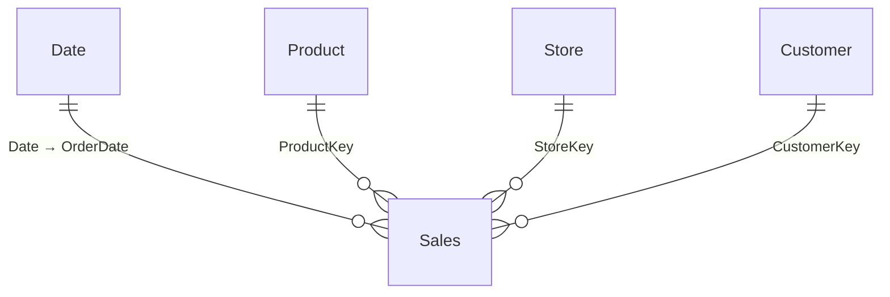

# Contoso Sales Analytics | Power BI

**Analiza sprzedaży, rentowności, kanałów i klientów**  
Autorka: **Małgorzata Gąsior**  
Narzędzia: **Power BI Desktop · Power Query · DAX**

[English summary](README_EN.md) · [Cel i pytania](docs/CEL_I_PYTANIA.md) · [Cel i pytania](docs/CEL_I_PYTANIA.md) · [Wnioski i rekomendacje](docs/WNIOSKI_I_REKOMENDACJE.md) · [Model danych](docs/MODEL_DANYCH.md) · [Miary DAX](docs/MIARY_DAX.md) · [Walidacja](docs/QA_I_JAKOSC.md)

Projekt portfolio przedstawia analizę danych sprzedażowych Contoso z wykorzystaniem czterostronicowego raportu Power BI. Jego celem jest wyjaśnienie, **jak zmieniła się sprzedaż, które kanały i kategorie odpowiadają za zmianę oraz jak zmieniła się aktywna baza klientów**.

> Prezentowane zrzuty pochodzą z raportu budowanego w Power BI Desktop. Pakiet nie zawiera pliku PBIX ani surowych CSV. Liczby dla 2023 zweryfikowano niezależnie na dostarczonych danych; kod miar w dokumentacji jest wersją referencyjną i wymaga porównania z końcowym PBIX przed publikacją jako dokładny eksport modelu.

## Executive summary

Dla **2023 roku**, wszystkich kanałów i kategorii, w porównaniu z pełnym 2022 rokiem:

| Wskaźnik | 2022 | 2023 | Zmiana |
|---|---:|---:|---:|
| Revenue | 47,71 mln | 35,22 mln | −26,2% |
| Gross Profit | 27,90 mln | 20,67 mln | −25,9% |
| Gross Margin | 58,48% | 58,67% | +0,20 p.p. |
| Orders | 18 895 | 15 503 | −18,0% |
| Active Customers | 16 388 | 13 746 | −16,1% |
| New Customers | 9 010 | 5 890 | −34,6% |
| Returning Customers | 7 378 | 7 856 | +6,5% |
| Online Revenue Share | 53,76% | 60,69% | +6,93 p.p. |

**Co wynika z danych?** Sprzedaż spadła, mimo że procentowa marża brutto nieznacznie wzrosła. Kanał stacjonarny odpowiadał za około **65,8% zmiany przychodu netto**, a kategoria Computers za około **53,1%**. Udział online wzrósł, mimo że jego przychód także spadł: sprzedaż stacjonarna spadła szybciej. Wnioski są opisem danych, a nie dowodem przyczyn biznesowych.

Wartości pieniężne podano **bez symbolu waluty**: dostarczone pliki nie potwierdzają waluty ani sposobu przeliczenia między krajami.

## Cel i pytania biznesowe

Odbiorcami case study są osoby odpowiedzialne za sprzedaż, kanały, kategorie i analizę klientów. Raport odpowiada na pytania:

1. Jak zmieniły się przychód, zysk brutto i marża względem porównywalnego okresu poprzedniego roku?
2. Jak zmieniły się liczba zamówień, liczba sztuk i średnia wartość zamówienia?
3. Jaki udział w zmianie przychodu miały kanały online i stacjonarny?
4. Które kategorie mają największy przychód, jaki generują poziom marży i gdzie wystąpiła największa zmiana kwotowa?
5. Jak zmieniła się liczba aktywnych, nowych i powracających klientów oraz wartość i liczba zamówień na klienta?
6. Jak wygląda miesięczna aktywność i struktura klientów według kraju ich profilu?

To projekt portfolio na dostarczonych danych; nie przedstawia wdrożenia komercyjnego ani wyników z pracy dla rzeczywistego klienta.

## Zakres danych i model

Źródło stanowi pięć plików CSV: `Sales`, `Product`, `Store`, `Customer` i `Date`. W danych występuje 199 873 pozycji zamówień i 83 130 unikalnych zamówień. Zakres dat zamówień to **1 stycznia 2015 – 20 kwietnia 2024**; kalendarz obejmuje cały 2024 rok.

Jedna pozycja tabeli `Sales` odpowiada jednej linii zamówienia. Model łączy ją relacjami 1:* z wymiarami daty, produktu, sklepu i klienta. Datą analizy sprzedaży jest **OrderDate**. Osobna tabela `_Measures` porządkuje miary; tabele `Comparison Year` i `Sales Bridge Steps` wspierają wybrane wizualizacje.

Pierwotne źródło, warunki wykorzystania i waluta nie zostały potwierdzone. Nazwa Contoso odnosi się do oznaczeń w dostarczonych danych; nie przypisuję zestawu do konkretnej publicznej publikacji bez potwierdzenia.

## Przygotowanie danych i ważne definicje

- W Power Query poprawiono nagłówki kalendarza oraz typy dat i liczb. W danych sprzedażowych występowały wartości tekstowe `#N/D`, puste pola i różne separatory dziesiętne. Jawna konwersja cen i kosztów była konieczna po wykryciu zawyżonych kwot w kontroli raportu.
- **Revenue** = suma `Quantity × UnitPrice` dla pozycji z dostępną ceną. Pięć pozycji bez ceny nie wnosi kwoty do przychodu.
- **Gross Profit** = suma `Quantity × (UnitPrice − UnitCost)` dla pozycji z dostępną ceną i kosztem. **Gross Margin** odnosi ten zysk do przychodu z tego samego kompletnego zakresu pozycji.
- **Orders** to liczba unikalnych `OrderKey`, a nie liczba wierszy sprzedaży. Jeden zakup może zawierać wiele pozycji.
- **New Customer** oznacza pierwszy zakup **zaobserwowany w dostępnym zbiorze**. Historia zaczyna się w 2015; nie wiadomo, czy był to pierwszy zakup klienta w historii firmy. Data pierwszego zakupu wyznaczana jest globalnie, a nie osobno dla wybranego kanału czy kategorii.
- **Returning Customers** to pozostali aktywni klienci, których pierwszy widoczny zakup był wcześniej. Ich liczba nie jest stopą retencji.
- Porównania PY mają obejmować analogiczne okresy. Dla 2024 dane kończą się 20 kwietnia; porównanie z pełnym 2023 byłoby mylące.

Szczegóły: [model](docs/MODEL_DANYCH.md), [słownik danych](docs/SLOWNIK_DANYCH.md) oraz [opis miar](docs/MIARY_DAX.md).

## Strony raportu

### 1. Sales Overview

Pięć KPI, miesięczny trend Revenue / Revenue PY, ranking pięciu kategorii oraz dynamiczne komentarze o wyniku, kategorii i kanałach. Strona odpowiada na pytanie: **co zmieniło się w wynikach?**

### 2. Sales & Channels

Orders, Units Sold i Average Order Value; waterfall zmiany przychodu według kanału; porównanie kanałów, struktura przychodu i miesięczna macierz zamówień. Udział kanału odnosi się do **wybranego zakresu filtrów**.

### 3. Product Performance

KPI produktów, wykres bąbelkowy przychodu i marży według kategorii, zmiana przychodu kategorii oraz komentarze o liderze i rentowności. Rozmiar bąbelka oznacza sprzedane sztuki.

### 4. Customer Overview

Aktywni, nowi i powracający klienci; przychód i zamówienia na klienta; miesięczna aktywność, struktura klientów oraz treemap według kraju profilu. Grupa **Other** obejmuje Netherlands, France i Italy — to stałe grupowanie, nie dynamiczne „poza Top 5”.

## Walidacja i ograniczenia

Niezależnie sprawdzono pliki CSV: brak duplikatów par `OrderKey + LineNumber`, brak niedopasowanych kluczy Customer, Product i Store w Sales oraz ciągłość kalendarza. Stwierdzono **5 braków ceny i 2 braki kosztu**; oba braki kosztu dotyczą pozycji, w których brakuje również ceny. Wszystkie te pozycje pochodzą z 2015 roku.

Wartości widoczne na przesłanych ekranach dla 2023 uzgodniono z niezależnym przeliczeniem CSV. Nie uruchomiono końcowego PBIX ani nie przetestowano w nim wszystkich miar i kombinacji filtrów. Plan testów i wyniki znajdują się w [QA_I_JAKOSC.md](docs/QA_I_JAKOSC.md).

Nie analizowano zwrotów, realizacji budżetu, kosztów marketingowych, zysku netto ani przyczyn rynkowych spadku. Liczby klientów z poszczególnych miesięcy nie sumują się do liczby unikalnych klientów w roku. Kraj na stronie Customers pochodzi z profilu klienta, nie musi być krajem dostawy.

## Dalsze kroki analityczne

1. Rozbić spadek kategorii Computers na marki, podkategorie i produkty oraz sprawdzić zmianę wolumenu i średniej ceny.
2. Porównać wyniki sklepów stacjonarnych, uwzględniając okres ich działania; ewentualne braki stanów magazynowych lub efekty promocji wymagają dodatkowych danych.
3. Sprawdzić, gdzie zmniejszyła się liczba klientów z pierwszym zaobserwowanym zakupem, pamiętając o ograniczonym początku historii.

Są to **kierunki dalszej analizy**, a nie potwierdzone przyczyny ani gwarancja efektu działań.

## Zawartość repozytorium

| Plik lub folder | Zawartość |
|---|---|
| `README.md` / `README_EN.md` | Opis projektu po polsku i angielski skrót |
| `images/` | Cztery przesłane zrzuty rzeczywistego raportu |
| `docs/` | Wyniki, model, definicje, walidacja oraz instrukcja publikacji |
| `dax/` | Referencyjne definicje miar, kolumn i tabel pomocniczych |
| `scripts/check_data.py` | Opcjonalna niezależna kontrola źródłowych CSV; nie jest eksportem PBIX |
| `report/` | Informacja o pliku Power BI i bezpiecznym zakresie publikacji |

Szczegółowy opis decyzji i wyliczeń: [Wnioski i rekomendacje](docs/WNIOSKI_I_REKOMENDACJE.md). Instrukcja dodania plików do repozytorium: [JAK_WGRAC_NA_GITHUB.md](docs/JAK_WGRAC_NA_GITHUB.md).
